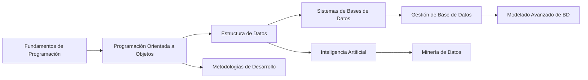
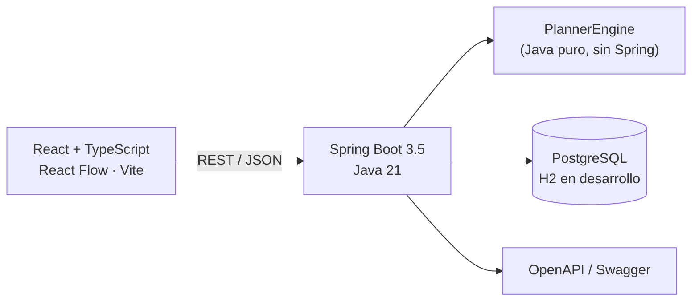
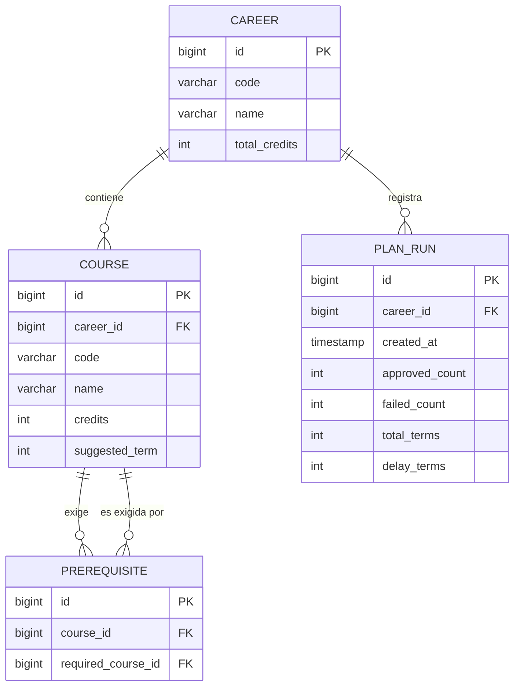

# MallaLab

> **No planifiques cursos. Simula tu camino al título.**

[](https://github.com/Corinaast/MallaLab/actions/workflows/ci.yml)


**MallaLab** convierte una malla curricular en un **grafo de prerrequisitos** y responde preguntas que ningún sistema de matrícula responde:

- *¿Cuántos semestres me faltan realmente para titularme?*
- *¿Qué pasa si pierdo Cálculo II?*
- *¿Cuál es el mínimo teórico de semestres de mi carrera?*
- *¿Qué materias me están bloqueando más cosas?*
- *Ármame el próximo semestre sin pasarme de créditos.*

> Demo: _pendiente de despliegue_ · API docs: `/docs`

---

## ¿Por qué este proyecto?

La mayoría de portafolios de estudiante tienen CRUDs, landings y calculadoras. MallaLab es distinto por tres razones:

1. **Tiene un motor algorítmico real**: DAG, orden topológico, detección de ciclos, camino crítico y planificación con restricciones.
2. **Tiene usuarios naturales**: cualquier estudiante de la carrera puede usarlo mañana mismo.
3. **Es visual**: el grafo se recolorea en vivo y el plan se recalcula al instante.

---

## Funcionalidades

| Funcionalidad | Estado |
|---|---|
| Malla cargada como grafo (46 materias, 120 créditos, 8 PAO) | ✅ |
| Vista interactiva con React Flow (aprobada / disponible / bloqueada / perdida) | ✅ |
| Simulación *what-if*: marcar materias perdidas y ver el retraso | ✅ |
| Plan semestre por semestre con tope de créditos configurable | ✅ |
| Ranking de cuellos de botella (materias que más desbloquean) | ✅ |
| Validación de la malla: detecta ciclos de prerrequisitos | ✅ |
| Historial de simulaciones guardadas (API) | ✅ |
| API documentada con OpenAPI/Swagger | ✅ |
| Multi-carrera | 🔜 |
| Login de estudiante (JWT) | 🔜 |
| Exportar el plan como imagen | 🔜 |

---

## Cómo funciona

### 1. La malla es un DAG

Cada materia es un nodo. Si *Estructura de Datos* exige *Programación Orientada a Objetos*, hay una arista `POO → Estructura de Datos`.



### 2. El motor responde cuatro preguntas

| Pregunta | Algoritmo | Complejidad |
|---|---|---|
| ¿La malla es válida? | Kahn (detección de ciclos) | `O(V + E)` |
| ¿Cuál es el mínimo de semestres? | Camino más largo en DAG | `O(V + E)` |
| ¿Qué materia desbloquea más? | Clausura transitiva sobre dependientes | `O(V · (V + E))`, se cachea |
| ¿Cómo armo el plan con tope de créditos? | Voraz por profundidad crítica + capacidad | `O(T · V log V)` |

El detalle completo, con las decisiones y los casos borde, está en [`docs/algorithms.md`](docs/algorithms.md).

### 3. La heurística de planificación

Por cada semestre:

1. Filtra las materias pendientes cuyos prerrequisitos ya están aprobados.
2. Las ordena por **profundidad crítica** (qué tan larga es la cadena que queda por debajo), luego por impacto y semestre sugerido.
3. Las coloca mientras no superen el tope de créditos.

Es determinista: el mismo escenario produce siempre el mismo plan, lo que hace la API trivial de testear y de cachear.

---

## Arquitectura



**Por qué el motor no depende de Spring:** `CurriculumGraph` y `PlannerEngine` son clases Java puras. Se pueden testear en milisegundos y reutilizar en otro proyecto (por ejemplo, un recomendador de cursos sobre un grafo de habilidades).

### Modelo de datos



---

## Stack

- **Backend**: Java 21 · Spring Boot 3.5 · Spring Data JPA · Flyway · H2 (dev) / PostgreSQL (prod) · JUnit 5 + AssertJ
- **Frontend**: React 18 · TypeScript · Vite · React Flow (`@xyflow/react`)
- **Infra**: Docker Compose · GitHub Actions · Maven

---

## Cómo correrlo

### Opción A — Docker (todo junto)

```bash
docker compose up --build
```

- Frontend: <http://localhost:5173>
- API: <http://localhost:8080/api/careers>
- Swagger: <http://localhost:8080/docs>

### Opción B — Local

**Backend** (solo necesitas JDK 21; el wrapper descarga Maven):

```bash
cd backend
./mvnw spring-boot:run     # en Windows: mvnw.cmd spring-boot:run
```

Arranca con H2 en memoria, aplica `V1__schema.sql` con Flyway y carga la malla semilla automáticamente.

**Frontend** (necesitas Node 20+):

```bash
cd frontend
npm install
npm run dev
```

Vite hace proxy de `/api` a `http://localhost:8080`, así que no hay que configurar CORS en desarrollo.

> Si el backend está apagado, la UI entra en **modo lectura**: muestra el grafo desde `public/malla-ti-espe.json` y desactiva la simulación.

### Tests

```bash
cd backend
./mvnw test
```

- `CurriculumGraphTest`: ciclos, orden topológico, camino crítico, clausura.
- `PlannerEngineTest`: topes de crédito, recursar, retrasos, prerequisitos.
- `MallaLabApplicationTests`: contexto completo, seed, endpoints y errores 404/400.

---

## API

| Método | Ruta | Descripción |
|---|---|---|
| `GET` | `/api/careers` | Lista de carreras |
| `GET` | `/api/careers/{code}/curriculum` | Materias, créditos y prerrequisitos |
| `GET` | `/api/careers/{code}/insights` | Mínimo teórico y cuellos de botella |
| `POST` | `/api/planner/simulate` | Simula un escenario |
| `GET` | `/api/planner/runs?career=TI-ESPE` | Últimas simulaciones guardadas |

**Ejemplo real: un alumno de 5.º semestre pierde Sistemas de Bases de Datos.**

El escenario completo (22 materias aprobadas de los primeros 4 semestres) está en [`docs/examples/perder-sistemas-bd.json`](docs/examples/perder-sistemas-bd.json):

```bash
curl -s http://localhost:8080/api/planner/simulate \
  -H "Content-Type: application/json" \
  -d @docs/examples/perder-sistemas-bd.json \
  | jq '{minTerms, baselineTerms, totalTerms, delay, totalCredits}'
```

```json
{
  "minTerms": 7,
  "baselineTerms": 4,
  "totalTerms": 5,
  "delay": 1,
  "totalCredits": 63
}
```

El plan devuelve los semestres que faltan, con la materia perdida marcada como `retake`:

```json
{
  "index": 2,
  "credits": 18,
  "courses": [
    { "code": "COMP-A0H02", "name": "Sistemas de Bases de Datos", "retake": true }
  ]
}
```

> No todo fracaso cuesta lo mismo: con el preset de 5.º semestre completo, perder
> *Estructura de Datos* da `delay: 0` (hay holgura para recuperarla); el mismo curso
> perdido en un escenario más ajustado sí retrasa. Esa diferencia es justamente lo
> que el motor permite descubrir.

---

## Decisiones de diseño

Están documentadas con su contexto en [`docs/decisions.md`](docs/decisions.md). Las tres que más se preguntan en una entrevista:

1. **El grafo se arma en memoria, no con consultas recursivas.** Con 46 materias el costo es despreciable y el motor queda testeable sin base de datos.
2. **Se usa camino crítico, no "cantidad de materias / créditos".** Un estudiante con 120 créditos puede estar a 6 o a 9 semestres del título; la diferencia está en las cadenas de prerrequisitos.
3. **La planificación es voraz y determinista, no óptima.** El problema general (con horarios y cupos) es NP-hard; para una malla de 46 nodos la heurística da planes sensatos y explicables. Se documenta la limitación en vez de esconderla.

---

## Problemas que resolví

- **El PDF de la malla venía desordenado por columnas.** Reconstruí las 8 PAO y normalicé los códigos (`EXCT A0301` → `EXCT-A0301`).
- **Ciclos en mallas reales.** Si una carrera publica un ciclo de prerrequisitos, la app no explota: detecta los nodos atrapados y responde `422` con la lista.
- **Materias con más créditos que el tope por semestre.** El planificador las agenda solas en un semestre en vez de entrar en deadlock.
- **Recursar sin duplicar.** Una materia perdida vuelve a la cola y se marca con `retake: true`; no se agenda dos veces en el mismo semestre.
- **Estados imposibles.** Al desmarcar o perder una materia, sus dependientes se desmarcan en cascada: el grafo nunca muestra una materia aprobada sin sus prerrequisitos.
- **Modo demo honesto.** Si la API no está, la UI no inventa resultados: muestra el grafo y avisa que la simulación está desactivada.

---

## Roadmap

- [ ] Multi-carrera desde la UI (importar malla en JSON)
- [ ] Login de estudiante y planes persistentes por usuario
- [ ] Exportar el plan como PNG para compartir
- [ ] Restricciones reales: horarios, cupos y profesores
- [ ] Comparador de escenarios ("pierdo B" vs "pierdo C")

---

## Autor

**Corina Acosta** — Ingeniería en Tecnologías de la Información, ESPE.

Proyecto académico y de portafolio. La malla semilla fue reconstruida a partir del documento público de la ESPE y es editable en `backend/src/main/resources/seed/malla-ti-espe.json`.

## Licencia

MIT.
