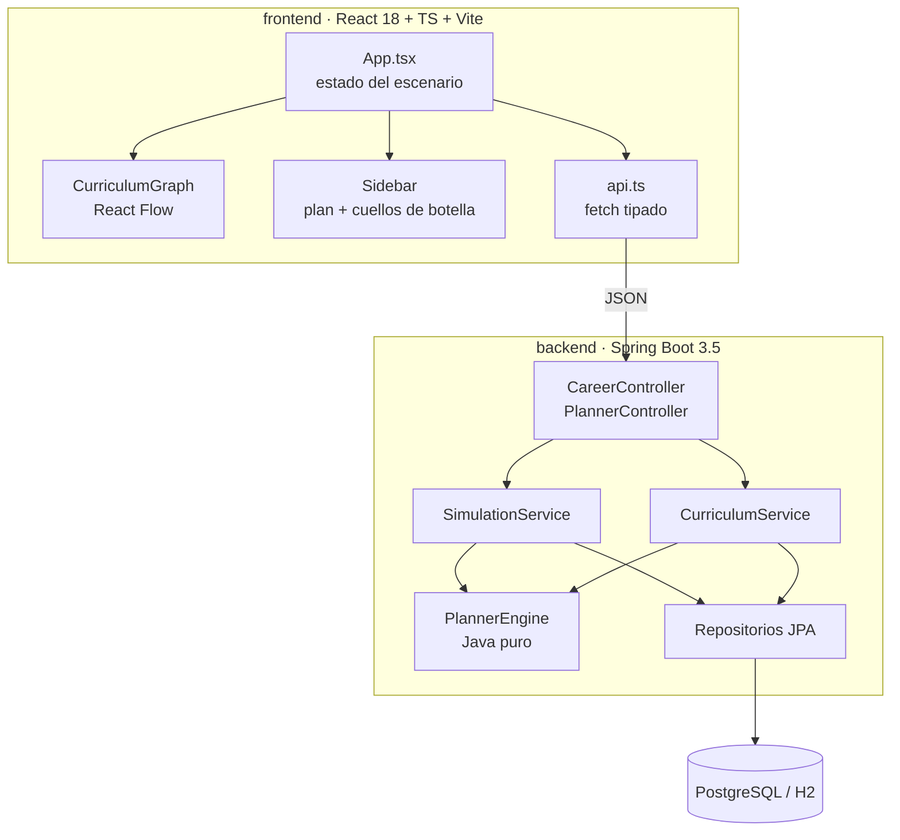
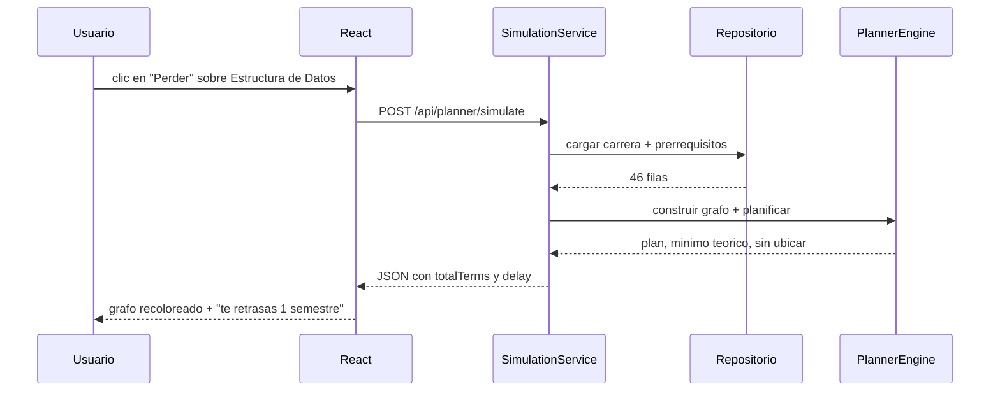

# Arquitectura

## Capas

| Capa | Paquete | Responsabilidad |
|---|---|---|
| API | `api` | DTOs, validacion, codigos HTTP, OpenAPI |
| Dominio | `planner` | Grafo, camino critico, planificador (sin frameworks) |
| Aplicacion | `catalog`, `history` | Carga de mallas, simulaciones guardadas |
| Persistencia | `catalog`, `history` | Entidades JPA y repositorios |
| Seed | `seed` | Carga idempotente de la malla desde JSON |

## Flujo de una simulacion

## Reglas de dependencia

- `planner` no importa nada de Spring, JPA ni de `api`.
- `api` no expone entidades JPA; siempre DTOs.
- La UI nunca calcula el plan: solo pinta lo que devuelve la API (salvo el modo lectura, que solo dibuja el grafo).
